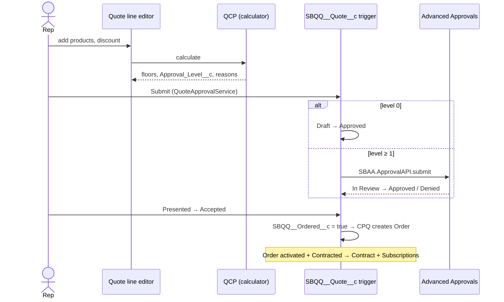
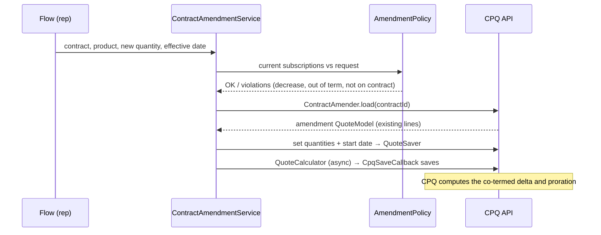

# Quote, order, amendment and renewal lifecycle

## New business



If an Approved or Presented quote is recalculated and its approval level goes **up**, the trigger
returns it to Draft. Re-pricing can't keep an approval that was given for a smaller ask.

## Advanced Approvals rules (configuration)

| Rule | Condition | Approver | Chain |
|---|---|---|---|
| Deal Desk | `Approval_Level__c >= 1` | Deal Desk queue | 1 |
| Finance | `Approval_Level__c >= 2` | Finance approver | 2 |
| CFO | `Approval_Level__c >= 3` | CFO | 3 |

One numeric field drives the rules, so routing logic lives in code (tested), and the rules stay trivial.

## Amendment (mid-term change)



## Renewal

```mermaid
sequenceDiagram
    participant F as Flow / scheduled job
    participant S as ContractRenewalService
    participant CPQ as CPQ API
    participant QCP as QCP
    F->>S: contract
    S->>CPQ: ContractRenewer.load(masterContractId, context)
    CPQ-->>S: renewal QuoteModel(s)
    S->>S: Prior_Net_Price__c, Grandfathered__c per line; Renewal_Cap_Pct__c from Account
    S->>CPQ: QuoteSaver, then QuoteCalculator
    CPQ->>QCP: onBeforeCalculate
    QCP-->>CPQ: special price = min(list, prior × (1+cap)), or prior if grandfathered
```
